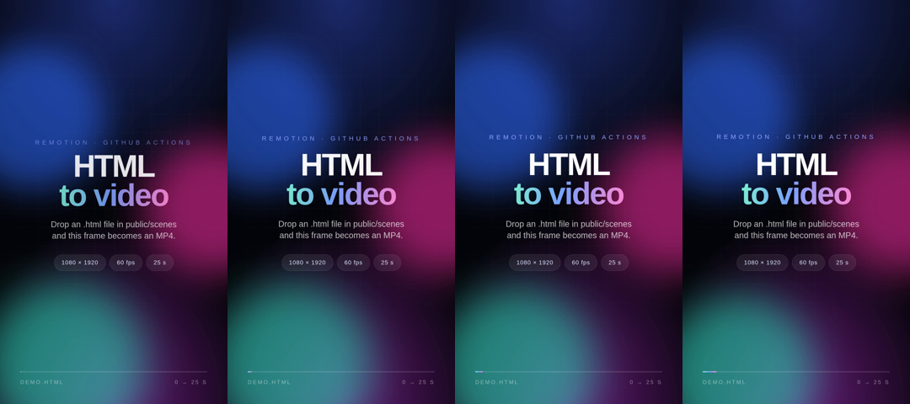

# HTML → Video render machine

Push an `.html` file, get an MP4 back. No local tooling, no editing software: this is a
**Remotion render farm that lives in your GitHub repo and runs on GitHub Actions**.

Every file in `public/scenes/` becomes its own video, rendered on its own GitHub runner,
uploaded as an artifact **and** attached to a GitHub Release you can download.

| Output spec | Value |
| --- | --- |
| Resolution | **1080 × 1920** (vertical 9:16) |
| Frame rate | **60 fps** |
| Duration | **25 s** exactly (1500 frames) |
| Codec | H.264 (`.mp4`), `yuv420p`, CRF 18 |
| Audio | optional, one file per scene |

Verified end-to-end: a full 25 s render of `public/scenes/demo.html` produced
`1080×1920 · 60 fps · 1500 frames · 25.000 s · 3.9 MB` (`docs/sample-demo-25s.mp4`).

> You wrote "vertical 1920×1080" — those numbers are landscape, so this is set to a true
> vertical **1080×1920**. Flip `width`/`height` in `video.config.json` if you actually
> wanted 16:9.

---

## Quick start

```bash
# 1. put the repo on GitHub (main branch)
git init -b main
git add . && git commit -m "html video renderer"
git remote add origin git@github.com:<you>/<repo>.git
git push -u origin main

# 2. drop an HTML file in
cp templates/starter.html public/scenes/my-first-video.html
git add public/scenes && git commit -m "new scene" && git push
```

That push triggers `.github/workflows/render.yml`:

1. **Plan** — scans `public/scenes/`, builds the matrix (1 scene = 1 runner).
2. **Render** — each scene is rendered in parallel with Remotion.
3. **Publish** — all MP4s become one artifact (`rendered-videos-<run>`) **and** a release
   tagged `render-<run number>`.

Manual run with options: **Actions → Render HTML → MP4 → Run workflow**
(`only` = comma-separated scene ids, `publish_release` = on/off).

Everything is downloadable from **Actions → run → Artifacts** (`rendered-videos-<n>`) and
from **Releases** (`render-<n>`).

### Pushing this repo for the first time

```bash
cd html-video-renderer
git init -b main
git add .
git commit -m "HTML → MP4 render machine (Remotion + GitHub Actions)"
git remote add origin git@github.com:<your-user>/<your-repo>.git
git push -u origin main
```

Then check **Settings → Actions → General → Workflow permissions** is set to
**Read and write** so the release step can publish MP4s.



*Four frames pulled from `docs/sample-demo-25s.mp4` — the HTML animates continuously across
the full 25 seconds.*

---

## Adding videos

One HTML file = one MP4. That's the whole contract.

```
public/
  scenes/
    promo.html            → out/scene-promo.mp4
    summer/sale.html      → out/scene-summer-sale.mp4   (sub-folders are fine)
  audio/
    promo.mp3             → automatically attached to scene-promo.mp4
```

* Name it anything; the MP4 is named `scene-<slugified file path>.mp4`.
* Audio is optional and matched by relative path (`scenes/summer/sale.html` →
  `audio/summer/sale.mp3`). Supported: `.mp3 .wav .m4a .aac .ogg .flac`.
* The HTML is served from the Remotion bundle, so sibling assets (images, CSS, fonts) work
  if you keep them next to the file inside `public/scenes/` — reference them relatively.

### How an HTML file is turned into frames

The page is mounted in a headless-Chrome iframe and **time-travelled**, frame by frame:

1. every CSS animation / transition / WAAPI animation is paused,
2. its `currentTime` is set to `frame / 60`,
3. the frame is screenshotted (`--remotion-time` and `--t` CSS variables are also updated),
4. repeat for all 1500 frames — in parallel, across as many browser tabs as the runner allows.

Because frames are captured **out of order and concurrently**, your HTML must be a pure
function of time:

* ✅ CSS animations, keyframes, transitions, `--t` / `--remotion-time` variables,
  `window.__seek(t)`.
* ✅ Static layout, images, gradients, SVG, embedded fonts.
* ❌ `Date.now()`, `setTimeout`, `setInterval`, `requestAnimationFrame` loops that mutate
  state, `Math.random()` at draw time — these produce flicker/duplicates in the render.
* ❌ Anything that needs the internet at render time — embed assets locally instead.

For `<canvas>` / WebGL / JS scenes, expose the timeline yourself:

```js
window.__seek = (t, { progress, duration }) => drawFrameAt(t); // t in seconds
window.__ready = myLoadingPromise; // optional: hold frame 0 until assets load
```

See `docs/AUTHORING.md` for the full contract, and `templates/canvas-example.html` for a
working example.

---

## Configuration

`video.config.json` — one file, no code:

```json
{
  "width": 1080,
  "height": 1920,
  "fps": 60,
  "durationInSeconds": 25,
  "backgroundColor": "#000000",
  "loopSeconds": null,
  "codec": "h264",
  "crf": 18,
  "imageFormat": "jpeg",
  "jpegQuality": 90,
  "x264Preset": "medium",
  "concurrency": "100%",
  "gl": "swangle"
}
```

| Key | Meaning |
| --- | --- |
| `width` / `height` | Canvas size. 1080×1920 = vertical, 1920×1080 = landscape. |
| `fps` / `durationInSeconds` | 60 × 25 = 1500 frames. Duration is exact. |
| `loopSeconds` | Repeat a shorter HTML animation inside the 25 s (e.g. `3` for a 3 s loop). `null` = one continuous 25 s timeline. |
| `crf` | Quality/size. 18 ≈ visually lossless, 20–23 = smaller files. |
| `x264Preset` | `faster` for speed, `slow` for smaller files at the same quality. |
| `concurrency` | Frames rendered in parallel. `"100%"` = all cores, or a number. |
| `gl` | `swangle` (CPU, reliable in CI) or `angle` (GPU/software GL). |

---

## Local use (optional)

```bash
npm install
npm run studio                     # live preview + timeline scrubbing in Remotion Studio
npm run render                      # renders every scene into out/
ONLY=scene-promo npm run render      # render one scene
npm run clean                        # delete out/ and the generated scene list
npm run clean -- --cache             # also drop the downloaded headless browser
```

Rendering locally needs the Chrome libraries (`libnss3`, `libgbm1`, …). On Debian/Ubuntu:

```bash
sudo apt-get install -y libnspr4 libnss3 libgbm1 libasound2t64 libatk1.0-0 \
  libatk-bridge2.0-0 libcups2 libdrm2 libxkbcommon0 libxcomposite1 libxdamage1 \
  libxfixes3 libxrandr2 libpango-1.0-0 libcairo2 fonts-liberation
```

The CI workflow installs these automatically if they're missing.

---

## Why it's efficient

* **One bundle per runner, reused for every scene** — webpack runs once.
* **A single headless browser** is shared by all compositions in a run (no per-scene launch).
* **Parallel frame capture** (`concurrency: 100%`) + pipelined ffmpeg encoding.
* **One runner per HTML file** — 5 HTML files render on 5 machines at once (`max-parallel: 8`).
* **Chrome Headless Shell is cached** across runs (keyed on `package-lock.json`), so the
  ~100 MB download happens once, not every run.
* **`npm` cache** via `setup-node`, `npm ci` for reproducible installs.
* **Bundling is skipped when nothing changed** — the workflow only runs on changes to
  scenes, audio, `src/`, config, or deps.
* **`concurrency` group cancels superseded runs** so you don't pay for stale renders.
* Measured here on a deliberately weak 2-core sandbox: **235 s for one 1500-frame video**
  (≈ 6.4 frames/s captured + encoded). A standard 4-core GitHub runner lands around
  **2–3 min per video**; N scenes take the same wall-clock time because they render in
  parallel on N runners.

Rough levers if you need it faster: `"x264Preset": "faster"`, `"crf": 21`,
`"imageFormat": "jpeg"` (already on), lower `concurrency` only if you hit OOM.

---

## Housekeeping / deleting old stuff

```bash
npm run clean                       # out/, render-report.json, src/scenes.generated.ts
npm run clean -- --cache            # + headless browser download
npm run clean -- --deps             # + node_modules (full reset)
```

* Delete a video by deleting its HTML file — the next run simply stops rendering it.
* Rendered MP4s are never committed to git (see `.gitignore`), so the repo stays small.
* Artifacts expire on their own: `video-<id>` after 14 days, `rendered-videos-<run>` after 30.
* Old releases: **Releases → delete**. Or keep only the last N with
  `gh release list --limit 100 | tail -n +11 | cut -f1 | xargs -n1 gh release delete -y`.

---

## Repo layout

```
public/scenes/            ← your HTML files (the input)
public/audio/             ← optional audio, matched by name
src/HtmlVideo.tsx         ← iframe + per-frame seek + audio
src/seek.ts               ← the time-travel engine (CSS/WAAPI/media/JS hooks)
src/Root.tsx              ← one Remotion composition per scene
src/scenes.generated.ts   ← auto-generated by the scanner (do not edit)
scripts/scan-scenes.mjs   ← finds HTML files, pairs audio, writes the composition list
scripts/plan.mjs          ← CI matrix planner
scripts/render-all.mjs    ← the renderer (bundle once, browser once, render all)
scripts/clean.mjs         ← housekeeping
templates/                ← starters, not rendered
video.config.json         ← resolution / fps / duration / quality
.github/workflows/        ← render.yml (the render machine), validate.yml (PR checks)
docs/AUTHORING.md         ← how to write HTML that renders deterministically
```

---

## Troubleshooting

| Symptom | Fix |
| --- | --- |
| Blank / black video | The HTML isn't 1080×1920 or has content waiting on a network request. Check the artifact `demo.mp4` renders fine, then compare. |
| Flickering or duplicated content | You're using `Date.now()`, timers or `Math.random()` at draw time. Make the scene a pure function of `t`. |
| Animation looks frozen | Animation is driven by JS you didn't expose — add `window.__seek(t)`. |
| Everything is 1 frame "behind" | Expected: frame N = `N/60` seconds. Offset your `animation-delay` if you want a beat. |
| `Failed to launch the browser process` | Missing system libs — the CI step installs them; locally run the `apt-get` line above. |
| Render times out (45 min) | Drop `concurrency`, or split the work with the `only` input. |
| Release not created | Check **Settings → Actions → Workflow permissions** is *Read and write*. |

---

## License / attribution

Built on [Remotion](https://remotion.dev). Remotion is free for individuals and small
companies; **companies with 4+ employees need a Remotion license** — see
[remotion.dev/license](https://remotion.dev/license).
